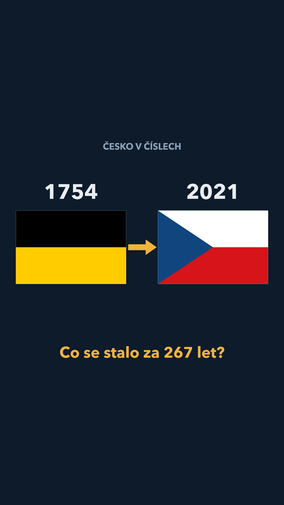
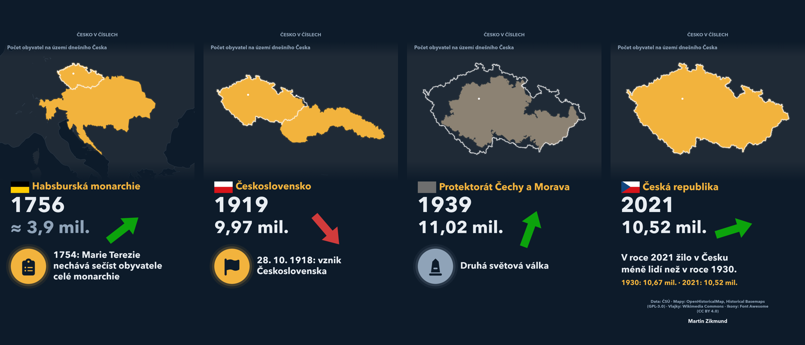
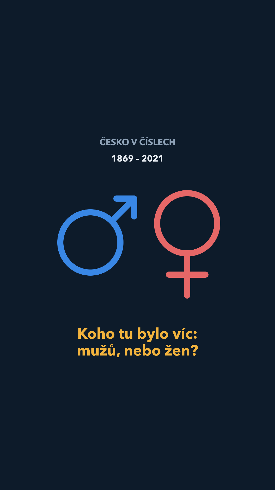

# Česko v číslech: 267 let v jedné animaci

Krátké svislé video (1080×1920, 89 s) o tom, kolik lidí žilo na území dnešního Česka od roku 1754
do roku 2021. Stačí tři jednoduché údaje (letopočet, počet obyvatel a hranice) a je v nich vidět
celý příběh země: změny států, dvě světové války, poválečný propad i obnova.

[](assets/video/cesko_v_cislech_cs.mp4)

**▶ Video:** [česky](assets/video/cesko_v_cislech_cs.mp4) · [English](assets/video/cesko_v_cislech_en.mp4)

**▶ Varianta „Muži a ženy“:** [česky](assets/video/cesko_v_cislech_cs_pohlavi.mp4) · [English](assets/video/cesko_v_cislech_en_pohlavi.mp4)



*English summary:* a vertical data animation of the population of today's Czechia from 1754 to 2021,
built from open data of the Czech Statistical Office (ČSÚ) and dated historical borders from
OpenHistoricalMap. Everything is rendered in Python; texts live in a separate file, so each language
version is rendered from the same code. **English video:** [cesko_v_cislech_en.mp4](assets/video/cesko_v_cislech_en.mp4)
(cover image: [obalka_en.png](assets/video/obalka_en.png)).

## Co video ukazuje

- **Mapa:** státní útvar, ke kterému území patřilo (Habsburská monarchie → Rakouské císařství →
  Rakousko-Uhersko → Československo → protektorát → Československo / ČSSR / ČSFR → Česká republika).
  Bílý obrys je vždy dnešní Česko, k jehož území se vztahují všechna čísla. Kamera se u velkých
  říší oddálí a u Československa a ČR přiblíží.
- **Útvar, vlajka, letopočet a počet obyvatel** se šipkou trendu. Šipka sleduje roční tempo změny
  a otáčí se se setrvačností, takže na události reaguje se zpožděním, stejně jako data.
- **Události** s ikonou: od soupisu Marie Terezie (1754) po sčítání uprostřed pandemie (2021).
- **Pointa:** sčítání 2021 napočítalo méně obyvatel (10,52 mil.) než sčítání 1930 (10,67 mil.).

## Varianta „Muži a ženy“ (1869–2021)

[](assets/video/cesko_v_cislech_cs_pohlavi.mp4)

Stejná osa a mapy, ale místo celkového počtu obyvatel ukazuje, koho tu žilo víc: mužů, nebo žen.

- **Vodorovný sloupec „přetlačování“:** muži modře zleva, ženy červeně zprava, v barvách skutečné počty.
  Hranice mezi barvami odpovídá podílu mužů. Podíl žen se v datech pohybuje jen mezi 50,7 a 52,0 %,
  proto má sloupec **zvětšené měřítko 45–55 %** (ve videu je to vyznačeno) a svislou čáru 50 : 50.
- **Šipky trendu** pro počet mužů a počet žen těsně vedle sebe (zelená = roste, červená = klesá).
- Začíná rokem 1869 (první sčítání s počty mužů a žen), letopočet běží plynule, podíl mezi sčítáními
  je dopočtený monotónní křivkou (PCHIP) a počty = celkový počet obyvatel × podíl.
- Popisky událostí jsou bez letopočtu; události, které nastaly o víc let dřív než sčítání, k němuž
  byly přiřazeny (Expo 58, Pražské jaro, sametová revoluce), se zobrazí ve svém skutečném roce.
- Události navíc vysvětlující poměr pohlaví: stagnace délky života mužů 1960–1990 a dohánění po roce 1989
  (ČSÚ, tab. 8.6), pracovní migrace (podle SLDB 2021 je 55 % cizinců mužů).
- Závěr: „Při každém sčítání žilo v Česku víc žen než mužů. 1921: o 403 tis. víc žen · 2021: už jen
  o 151 tis.“ a poznámka o „efektu vracejících se vojáků“ (MacMahon & Pugh 1954, Graffelman & Hoekstra 2000).

Naděje dožití mužů a žen 1920–2024 je připravená v `data/nadeje_doziti.csv` pro další video.
Verze s hudbou (Uppbeat) se v repozitáři nešíří; hudba se licencuje zvlášť.

## Data a metodika

| Období | Zdroj | Poznámka |
|---|---|---|
| 1754–1850 | ČSÚ, Demografická příručka 2024, tab. 1.2 | odhady přepočtené na dnešní území; ve videu označené „≈“ |
| 1857–2021 | ČSÚ, Demografická příručka 2024, tab. 1.2 a 1.12 | výsledky sčítání lidu přepočtené na dnešní území |
| 1919–1920, 1931–1949 | ČSÚ, Demografická příručka 2024, tab. 1.5a | roční střední stav; ve válečných obdobích nahrazuje lineární dopočet mezi sčítáními |
| 1911–1917 | ČSÚ, tab. 1.3 (historické území) | **vlastní dopočet**: tvar křivky z historického území, přepočtený poměrem na dnešní území |

Mezi ostatními sčítáními počítadlo dopočítává lineárně. Metodika sčítání se v čase mění
(do roku 1950 přítomné obyvatelstvo, 1961–2001 trvale bydlící, od roku 2011 obvykle bydlící).

**Hranice:** útvary od roku 1852 a obrys dnešní ČR pocházejí z [OpenHistoricalMap](https://www.openhistoricalmap.org)
(CC0), kde jsou hranice uvedené k datu, včetně protektorátu (1939–1945) a stavu po Mnichovu
(11/1938 – 3/1939). Habsburská monarchie 1754–1800 a šedé okolí jsou z
[Historical Basemaps](https://github.com/aourednik/historical-basemaps) (GPL-3.0) s opravami:
pro rok 1754 bez Haliče a Bukoviny (připojeny 1772/1775), okraje zarovnané na obrys ČR.

**Vlajky:** Wikimedia Commons (public domain). Pro Rakousko-Uhersko je použitá obchodní vlajka,
protože společnou státní vlajku monarchie neměla. Protektorát má místo vlajky záměrně šedé pole.

**Ikony:** [Font Awesome Free](https://fontawesome.com) 6.5.2 (ikony CC BY 4.0, font SIL OFL 1.1).

### Kontrola faktů

Před zveřejněním proběhla kontrola všech čísel a událostí proti zdrojům. Tyto věci se při ní opravily:

- Počítadlo mezi sčítáními 1930 a 1950 původně dopočítávalo přímku, a tak počet klesal už od roku
  1930. Podle ročních údajů ČSÚ ale počet obyvatel rostl až do roku 1940 (11,16 mil.) a propadl se
  až v letech 1945–1947 (na 8,77 mil.).
- Mapa pro rok 1754 obsahovala Halič a Bukovinu, které Habsburkové získali až později.
- Sčítání 1857 bylo nesprávně označeno za „první moderní“ (tím je sčítání 1869).

Známá zvláštnost dat: střední stav ČSÚ roste mezi lety 1938 a 1939 o 2,1 %, výrazně víc než
okolní roky. Video ho ukazuje tak, jak je publikovaný.

## Jak video vyrenderovat

Potřeba je Python 3.9+ a balíčky z `requirements.txt` (`ffmpeg` dodává balíček `imageio-ffmpeg`).
Písmo je Avenir Next (systémové písmo macOS); na jiném systému změňte konstantu `FONT` v `src/video.py`.

```bash
pip install -r requirements.txt
python3 src/mapy.py          # stáhne hranice (OpenHistoricalMap, Historical Basemaps) a připraví data/mapy/
python3 src/rocni_odhady.py  # roční počty obyvatel pro válečná období -> data/rocni_odhady.csv
python3 src/nadeje_doziti.py # naděje dožití podle pohlaví -> data/nadeje_doziti.csv (pro další video)
python3 src/video.py         # video -> assets/video/cesko_v_cislech_cs.mp4
python3 src/video.py --varianta pohlavi   # varianta „Muži a ženy“ -> cesko_v_cislech_cs_pohlavi.mp4
```

Užitečné přepínače `src/video.py`: `--nahled` (poloviční rozlišení), `--snimek 49` (jeden snímek
v čase 49 s do PNG), `--obalka` (obrázek náhledu pro sociální sítě a ukázka ořezů 4:5 a 1:1),
`--jazyk en` (texty z `texty/en.json`).

## Struktura

```
data/raw/            původní tabulky ČSÚ (xlsx)
data/timeline.csv    osa videa: rok, typ údaje, počty, útvar, vlajka, mapa, událost, ikona
data/rocni_odhady.csv  roční počty pro válečná období
data/mapy/           hranice pro jednotlivá období (GeoJSON)
texty/cs.json        všechny texty videa; texty/en.json anglická verze se stejnými klíči
texty/prispevky_cs.md  texty příspěvků pro Facebook a LinkedIn (+ prispevky_en.md, youtube_pohlavi.md)
data/nadeje_doziti.csv naděje dožití mužů a žen 1920–2024 (ČSÚ tab. 8.6)
src/                 skripty (mapy, roční odhady, render videa, náhledy)
assets/              vlajky, ikony, náhledy map, hotové video a obrázek náhledu
```

## Licence

Kód je pod licencí MIT (viz `LICENSE`). Data a podklady mají vlastní licence: data ČSÚ
(otevřená data, s uvedením zdroje), OpenHistoricalMap (CC0), Historical Basemaps (GPL-3.0; odvozené
geometrie v `data/mapy/` přebírají tuto licenci), vlajky (public domain), Font Awesome (CC BY 4.0 / OFL,
viz `assets/ikony/FONTAWESOME_LICENSE.txt`).

Autor: Martin Zikmund
